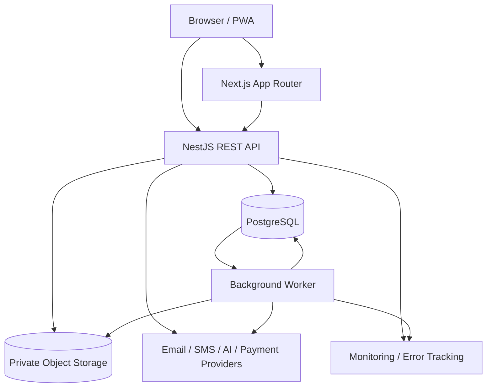

# ServiceFlow — Phase 0 Product, Architecture & Engineering Specification

- **Document ID:** SF-ENG-SPEC-001
- **Version:** 1.0.0-draft-for-implementation
- **Status:** Phase 0 frozen; Phase 1 authorized to begin
- **Date:** 2026-11-19
- **Product:** ServiceFlow
- **Initial market:** Computer/laptop retailers and repair/service centres, initially Bangladesh
- **Primary currency/locale:** BDT; Bangla and English
- **Timezone for display:** Asia/Dhaka
**Architecture status:** Approved baseline; implementation and deployment choices remain subject to validation

---

## 0. Document authority and interpretation

This document consolidates the ServiceFlow Phase 0 product and architecture decisions. It is the baseline for implementation, code review, testing and subsequent architecture decision records (ADRs).

Decision labels:

- **CONFIRMED** — selected during Phase 0 and treated as the baseline.
- **RECOMMENDED BASELINE** — a concrete engineering design derived from confirmed decisions; validate during implementation.
- **DEFERRED** — intentionally outside the initial implementation scope.
- **OPEN IMPLEMENTATION DETAIL** — does not block Phase 1; decide when the relevant vertical slice is implemented.
- **LEGAL REVIEW REQUIRED** — requires review against applicable law, contracts and current regulatory guidance.

This document does not claim that the application has been implemented, tested, deployed, security-assessed or legally certified. Targets become commitments only after implementation, measurement and appropriate review.

### 0.1 Change control

- Keep this file in Git and update it through pull requests.
- Material architecture changes require an ADR in `docs/architecture/decisions/`.
- Do not silently replace confirmed decisions. Propose a change with context, alternatives, consequences, migration plan and tests.
- Product/domain requirements may be refined in implementation, but security, tenant isolation, financial integrity and audit invariants cannot be weakened casually.
- When a detail is not yet known, mark it open instead of inventing a value.

---

# 1. Product definition

## 1.1 Vision

ServiceFlow is a multi-tenant SaaS platform for computer/laptop retail shops and repair/service centres. It brings retail operations, inventory, repair workflows, customer service and customer-facing experiences into one system.

The initial product must support real business workflows rather than a collection of disconnected CRUD screens.

## 1.2 Target users

- Shop owners and business administrators.
- Branch managers.
- Sales executives and cashiers.
- Inventory and purchasing staff.
- Repair technicians.
- Receptionists.
- Customers.
- ServiceFlow platform administrators and authorized platform security operators.

## 1.3 Product workspaces

Four business-facing workspaces share one backend and one business data model:

1. **Business administration:** employees, roles, branches, inventory, suppliers, purchasing, reports, settings, audit.
2. **Sales workspace:** POS, barcode/product lookup, stock visibility, invoices, customer registration, authorized discounts/refunds.
3. **Technician workspace:** assigned repairs, diagnosis, notes, status, parts, quality checks and service history.
4. **Customer portal:** personal purchases, repairs, invoices, warranties, support and notifications.

A separate **ServiceFlow platform administration boundary** manages platform-level onboarding, tenant lifecycle and security. Platform administrators are not automatically business administrators and do not receive unrestricted access to tenant business data.

## 1.4 Core capabilities

### Retail
- Product catalogue and variants.
- SKU, barcode and manufacturer serial-number handling.
- Inventory balances and stock movement ledger.
- Suppliers, purchase orders and receiving.
- POS, sales, invoices, payments, refunds and reversals.
- Public storefront, online orders, delivery and branch pickup.

### Repair
- Device intake and condition documentation.
- Repair tickets and diagnosis.
- Versioned quotations and customer approval.
- Technician assignment and repair work.
- Parts consumption.
- Quality check, collection and repair warranty.
- Device and service history.

### Customer experience
- Customer portal and verified guest updates where allowed.
- Purchase, repair, invoice and warranty history.
- Support requests and customer-visible messages.
- Email, SMS and in-app notifications.
- Customer notification preferences and separate marketing consent.

### Platform and governance
- Tenant onboarding and lifecycle.
- Role-based access and scoped permissions.
- Business and security audit.
- Data retention and deletion workflows.
- Investigation, evidence, alert and remediation capabilities, introduced progressively.
- AI assistance with explicit human confirmation for consequential actions.

## 1.5 Product principles

1. Backend is authoritative for business rules and permissions.
2. Tenant boundaries apply to every tenant-owned record and derived representation.
3. Financial and inventory changes are transactional and auditable.
4. Historical business facts are not overwritten to make a new state appear to have always existed.
5. External providers fail independently where safe.
6. Core workflows must not depend on AI availability.
7. AI assists; it does not independently authorize refunds, warranty decisions, stock adjustments or repair approvals.
8. Implement a modular monolith before considering microservices.
9. Deliver vertical slices, not isolated layers of unfinished CRUD.
10. Avoid speculative infrastructure and abstractions.

---

# 2. Scope and release strategy

## 2.1 Commercial MVP

The first useful commercial release should deliver:

- Tenant registration, approval and activation.
- Authentication, sessions, memberships and permissions.
- One branch per business initially, with multi-branch-capable design.
- Product catalogue and inventory.
- Suppliers, purchase orders and receiving.
- POS, sales, payments, invoices and basic refunds.
- Repair intake, diagnosis, quotation, approval, work and collection.
- Customer portal.
- Essential support and notifications.
- Business audit and operational reporting.
- Platform administration sufficient to manage tenants.

## 2.2 Progressive release plan

| Release | Scope |
|---|---|
| 0.1 Foundation | Monorepo, CI, database, identity, tenant lifecycle, membership, authorization, audit foundations |
| 0.2 Catalogue and inventory | Products, variants, stock ledger, balances, suppliers, purchasing, receiving |
| 0.3 Retail | POS, sales, payments, invoices, refunds, storefront order foundation |
| 0.4 Repairs | Intake, diagnosis, quotations, approvals, work, parts, quality check, collection, warranty |
| 0.5 Customer experience | Customer portal, support, notifications, delivery/pickup |
| 0.6 AI assistance | Permission-scoped assistive capabilities and human handoff |
| 1.0 Integrated MVP | End-to-end workflows, operational readiness, security assessment and release gates |

Build vertical slices with tests, documentation and usable UI at each milestone.

## 2.3 Deferred capabilities

Do not block the MVP on:

- Subscription billing and payment collection for ServiceFlow itself.
- Advanced autonomous AI.
- Custom tenant domains.
- Official bKash/Nagad/payment gateway integrations.
- Advanced accounting, tax and statutory reporting.
- Courier APIs.
- Native iOS/Android applications.
- Complex warehouse management.
- Predictive analytics and a dedicated data warehouse.
- Dedicated search engine, Redis or message broker before measured need.
- Active-active multi-region infrastructure.
- Full advanced investigation/detection governance before core commercial workflows are usable.

---

# 3. Confirmed product and business decisions

## 3.1 Tenant and onboarding model

- Multi-tenant SaaS.
- Shared PostgreSQL database and schema initially.
- Tenant-owned rows include `tenant_id`; composite constraints and foreign keys protect tenant consistency.
- Application authorization is mandatory; PostgreSQL Row-Level Security (RLS) provides an additional isolation layer.
- Tenant ID is derived from authenticated membership and trusted server-side context, never accepted from a browser as proof of authority.
- One identity can belong to multiple businesses.
- Self-service business registration requires platform approval.
- Platform administrators can also create businesses.
- Tenant lifecycle: `PENDING`, `ACTIVE`, `SUSPENDED`, `CLOSED`.
- Suspension blocks normal business operations while preserving records for authorized review and recovery.
- Free initial subscription model; no billing engine in MVP.

## 3.2 Roles and authorization

Initial role templates:

- Owner
- Administrator
- Branch manager
- Sales executive
- Inventory manager
- Technician
- Receptionist
- Customer

Predefined role templates plus custom tenant roles.

Authorization is RBAC with scoped permissions:

- Code-defined permission catalogue and role templates.
- PostgreSQL stores custom roles, role-permission assignments, user-role assignments and scopes.
- Only known code-defined capabilities can be granted.
- Permission IDs are stable and versioned.
- Prevent removal of the last authorized owner.
- No arbitrary permission wildcards.
- Branch visibility and permission to perform an action are separate.
- Backend authorization is authoritative.
- Maker-checker: permission to initiate a sensitive operation is distinct from permission to approve it.
- Platform authority is a separate authorization path.

Example permission identifiers:

```text
sales.create
sales.discount.apply
sales.refund.initiate
sales.refund.approve
inventory.receive
inventory.adjust
inventory.transfer.request
inventory.transfer.approve
repairs.assign
repairs.quote.create
repairs.quote.approve.record
audit.view.tenant
audit.view.branch
audit.export
platform.tenant.approve
platform.tenant.suspend
platform.audit.security.view
```

These are examples, not a complete final permission catalogue. Build and test the catalogue by module.

## 3.3 Branch scope

- Employees can have business-wide visibility where permitted.
- A selected branch is workspace context, not proof of authority.
- Branch-specific operations validate the branch against tenant membership and operation scope.
- Cross-branch operations validate both source and destination.
- Business-wide operations do not receive artificial branch IDs.
- Switching tenant clears sensitive client caches.

## 3.4 Retail and financial rules

- POS and online storefront are both in the first commercial release.
- Cash, card and MFS payments can be recorded manually initially.
- Payment gateway integration is deferred.
- Distinguish `Order`, `Sale`, `Payment`, `Invoice` and `StockMovement`.
- Online orders may exist before payment.
- Support partial payments, refunds, reversals, cancellations and reconciliation.
- Invoice sequence is business-wide and generated atomically in the database.
- Invoice number is not a database primary key.
- Issued invoices are preserved; corrections use explicit credit/reversal/correction records.
- Shared inventory must prevent overselling under concurrency.
- Money uses integer minor units or fixed-precision decimal, never binary floating point.
- Currency is configurable, initially BDT.
- Financial reports distinguish gross sales, net sales, collected payments and outstanding balances.

## 3.5 Inventory rules

- Support formal purchase orders and direct receiving.
- A purchase order is not proof of goods received.
- Stock increases only on accepted receiving or another authorized stock movement.
- Partial receipts, damaged goods, supplier returns and cancellations are explicit.
- Product kinds: `RETAIL`, `REPAIR_PART`, `BOTH`.
- Available stock = physical stock − reserved stock.
- Insufficient-stock override requires manager authorization, reason and audit; it must not invent physical stock.
- Backorder is an explicit authorized state.
- Branch transfers support direct permission-based transfer and request/confirmation.
- Transfer lifecycle: draft → approved → dispatched/in transit → received → completed, with discrepancies recorded.
- Stock ledger is authoritative history; balance is a transactional projection.

## 3.6 Repair rules

- Paid repair work requires explicit customer approval.
- Free warranty inspection or preauthorized work can follow a separately defined policy.
- Existing and walk-in customers are supported.
- Both manufacturer/product warranty and shop repair warranty are tracked.
- A device can have multiple repair tickets; service history is preserved.
- Revised quotation requires fresh approval.
- Approval records actor, time, method, quotation version and status.
- Intake records device condition, reported issue, accessories, serial number, photos and acknowledgement.
- Repair state transitions and their actor/time are recorded.

Suggested repair lifecycle:

```text
RECEIVED
  -> DIAGNOSIS
  -> AWAITING_APPROVAL
  -> APPROVED
  -> IN_PROGRESS
  -> QUALITY_CHECK
  -> READY_FOR_COLLECTION
  -> COMPLETED
```

Additional states: `ON_HOLD`, `REJECTED`, `CANCELLED`, `UNREPAIRABLE`.

The transition matrix, permitted roles and guards must be encoded and tested rather than allowing arbitrary status updates.

## 3.7 Support and notifications

- Unified support for repair, sales, warranty, order, product enquiry and general requests.
- Customers use the portal; employees may create requests on behalf of customers.
- Internal notes are distinct from customer-visible messages.
- Warranty claims have their own workflow.
- Guest updates require verification.
- Email, SMS and in-app notifications.
- Customer preferences are respected where permitted; legally/operationally necessary transactional messages may have different treatment.
- Marketing consent is separate.
- Provider-independent email/SMS adapters.
- Delivery state, attempts and retries are recorded.
- Transactional outbox is used for reliable asynchronous delivery.

## 3.8 Barcode and storefront

- Support USB/Bluetooth keyboard-wedge scanners and camera scanning.
- Barcode identifies catalogue item; manufacturer serial identifies a physical unit.
- Track serial numbers for products where applicable.
- POS and storefront share catalogue and inventory authority.
- Online delivery and in-store pickup.
- Public catalogue/prices; login required for checkout.
- Delivery address, fee and status are recorded.
- Pickup branch and collection verification are recorded.

## 3.9 AI

- Customer and employee AI assistance.
- AI can answer, prepare actions and recommend; consequential execution requires human confirmation.
- Human handoff creates or routes a support request.
- AI tools are permission-checked backend operations and use verified tenant context.
- Capability levels: read-only, prepare, execute-after-confirmation.
- No autonomous refunds, warranty decisions, stock adjustments or repair approvals.
- Provider abstraction and graceful fallback.
- No customer passwords, tokens, payment credentials or unnecessary personal data in model context.
- No cross-tenant retrieval.
- Do not use customer conversations for model training without a separately lawful and transparent basis.

---

# 4. Non-functional requirements and quality attributes

These are design targets to validate through testing and operations, not guarantees.

## 4.1 Security

- Strict tenant isolation.
- Email/password authentication.
- MFA for platform administrators, business owners and administrators; TOTP initially, recovery codes, passkeys later.
- Argon2id or an appropriately configured modern password hash.
- Single-use, expiring password reset tokens.
- Email verification.
- Secure session rotation on login, MFA and privilege changes.
- Rate limits and account enumeration resistance.
- Secure cookies: `HttpOnly`, `Secure`, appropriate `SameSite`.
- CSRF protection for cookie-authenticated state-changing requests.
- Explicit CORS origins; no wildcard credentialed CORS.
- Restricted production access and break-glass workflow.
- Critical actions and sensitive access audited.
- Secrets in a secret manager, never source control.
- Private object storage and short-lived signed URLs.
- Validate uploaded file content, not just declared MIME type.
- Malware scanning/quarantine and upload size limits.
- Dependency, secret and container scanning as the pipeline matures.

## 4.2 Tenant isolation and RLS

- Shared database/schema.
- Tenant-aware unique constraints and composite foreign keys.
- Application checks plus PostgreSQL RLS.
- Runtime database role must not have `BYPASSRLS`.
- Consider `FORCE ROW LEVEL SECURITY`.
- Tenant context is transaction-local, set only by trusted backend code.
- Never trust browser-supplied tenant ID.
- Use transaction-scoped Prisma helper for tenant-owned queries.
- Test SELECT, INSERT, UPDATE and DELETE policies.
- Test connection-pool reuse and concurrent requests for tenant-context leakage.
- Platform-level tables and carefully scoped exceptional access require separate policies.
- RLS is defense in depth, not a replacement for application authorization.

## 4.3 Availability and reliability

- Initial availability objective: 99.5% monthly.
- Health checks, error monitoring and operational alerting.
- Graceful degradation for optional providers.
- Critical business writes fail safely if required dependencies are unavailable.
- Public status page hosted independently.
- Critical-only 24/7 on-call; lower-severity coverage during working hours.
- Post-incident review required for material incidents.
- Customer communications should avoid sensitive technical/security details.

## 4.4 Disaster recovery and backups

Initial objectives:

- RPO: 15 minutes.
- RTO: 1 hour.

Backup baseline:

- Daily backups retained for 30 days.
- Monthly recovery points retained for 3 months.
- PITR/WAL archiving for the provider-supported recent window.
- Encrypted backups independent of the primary failure domain.
- Include database, object files and required configuration.
- Perform restore drills.
- Treat targets as unproven until drills demonstrate them.

## 4.5 Performance and capacity

Initial targets:

- Common API p95 under 500 ms.
- Product/barcode lookup p95 under 300 ms.
- Dashboard initial load under 2 seconds.
- Storefront initial load under 3 seconds.

Early commercial planning target:

- 50 active businesses.
- Up to 500 registered employees.
- Approximately 200 concurrent authenticated users.

Use pagination, tenant-aware indexes, bounded queries, selective caching, background jobs and rate limits. Model uneven tenant traffic and anonymous storefront requests. Load-test critical POS concurrency.

## 4.6 Localization and accessibility

- Bangla and English from first release.
- WCAG 2.2 AA target.
- Locale-aware dates, numbers and currency.
- Store timestamps in UTC; display in `Asia/Dhaka` as appropriate.
- Test Bengali Unicode, fonts, input, search and PDF/invoice output.
- Use `Intl.NumberFormat` and `Intl.DateTimeFormat`.
- Avoid floats for money.

## 4.7 Device and browser support

- Responsive desktop, laptop, tablet and smartphone.
- PWA; no native apps in MVP.
- Current and previous major Chrome, Edge, Firefox and Safari.
- Desktop primary for administration/POS.
- Tablet suitable for technicians.
- Smartphone primary for customer portal.
- Hardware scanner keyboard input and feature-detected camera scanning.
- Playwright browser testing for critical workflows.

## 4.8 Offline behaviour

- Limited offline app shell and eligible drafts.
- IndexedDB for drafts.
- Critical transactions remain online-only initially: sales, inventory changes, refunds and repair approvals.
- Explicit offline indicator.
- Local draft state distinct from server-committed state.
- Revalidate session, tenant, permission and record version on reconnect.
- Idempotency keys and conflict review.
- Do not store credentials, tokens or payment data in drafts.
- Minimize PII, expire drafts and clear sensitive client state on logout/account switch.
- Browser-side encryption has limitations; do not promise protection against a compromised browser/device.

## 4.9 Observability

- Structured JSON application logs.
- Error tracking.
- Latency, throughput, DB, worker, queue, backup and availability monitoring.
- Correlation IDs across HTTP requests and background jobs.
- OpenTelemetry-compatible design; tracing introduced when useful.
- Separate application logs, security events and business audit.
- Redact passwords, tokens, cookies, OTPs, recovery codes, payment credentials and unnecessary PII.
- Alert on sustained thresholds; deduplicate noisy alerts.
- Independent alert channel for monitoring-system failure.

## 4.10 Deployment and environments

Three environments:

1. Development.
2. Staging.
3. Production.

Separate database, storage and credentials. Staging uses synthetic or anonymized data.

Hosting direction:

- Managed PostgreSQL with PITR.
- Application hosting capable of multiple instances.
- Independent private object storage.
- External monitoring and backup controls.
- CI tests followed by manual production approval.
- Rolling deployment with readiness/liveness checks and graceful shutdown.
- Expand-and-contract migrations.
- Build once and promote the same artifact.
- Automatic application rollback only for defined sustained application-health failures; never assume code rollback reverses a database migration.
- Migration credentials separate from runtime credentials.

## 4.11 Incident and vulnerability management

- Critical-only 24/7 on-call.
- Customer-facing incident status for material outages.
- Post-incident reviews with impact, timeline, causes, corrective actions, owners and deadlines.
- Coordinated vulnerability disclosure without initial bounty.
- Public security contact/reporting process and defined scope/safe-harbour language reviewed before publication.
- Risk-based vulnerability remediation targets and documented exceptions.
- Independent penetration test before public launch and after material security architecture changes.

## 4.12 Privacy, retention and residency

- Data minimization and purpose-based access.
- Customer access, correction and verified deletion workflows where permitted.
- Account deletion is distinct from deleting financial/repair transaction records.
- Separate customer identity/profile from business transaction history.
- Legal holds override ordinary deletion.
- Retention policy service, deletion orchestrator, audit and deletion ledger.
- Backups expire by schedule; after restore, replay applicable deletion ledger before customer access.
- Derived data, caches, search indexes, exports and AI context are included in retention/deletion design.
- Regional/international approved providers may be used subject to applicable transfer requirements, safeguards, contracts and legal review.
- One primary application/database region initially; no active-active multi-region design.
- **LEGAL REVIEW REQUIRED:** Bangladesh's applicable personal-data law, rules, transfer requirements, sector obligations, retention, consumer protection, warranty, tax and invoice rules. Verify current official instruments and regulations with qualified counsel before production provider selection and customer contracts. This document is not legal advice.

---

# 5. Architecture baseline

## 5.1 High-level architecture



Frontend and backend are independently deployable applications in one pnpm monorepo. The backend is a modular monolith. Workers can run as a separate process from the same backend codebase.

## 5.2 Technology baseline

| Layer | Baseline |
|---|---|
| Runtime language | TypeScript, strict mode |
| Frontend | Next.js App Router, React |
| Styling/components | Tailwind CSS, shadcn/ui, accessible primitives |
| Frontend forms | React Hook Form + Zod |
| Server state | TanStack Query where client synchronization is needed |
| Shared UI state | React state/Context; Zustand only if justified |
| Offline drafts | IndexedDB |
| Backend | NestJS |
| API | REST under `/api/v1` |
| Contract | OpenAPI generated from NestJS DTO metadata |
| Frontend API client | Generated from OpenAPI |
| Database | PostgreSQL |
| ORM | Prisma |
| DB-specific SQL | Controlled parameterized SQL |
| Package manager | pnpm workspaces |
| Repository | Monorepo |
| Sessions | Backend-managed secure cookie sessions |
| Jobs | PostgreSQL-backed workers and transactional outbox initially |
| File storage | Local development adapter; private object storage in staging/production |
| Tests | Unit, real-PostgreSQL integration, API/contract, Playwright E2E |
| CI | Static/type checks, tests, build, security scans and staging smoke checks |

Exact dependency versions must be selected and locked during Phase 1. Do not install arbitrary `latest` versions without checking compatibility.

## 5.3 Frontend rendering and state

- Next.js App Router.
- Server Components by default for server-rendered, non-interactive content.
- Client Components for POS interactions, scanning, complex forms and interactive workspace state.
- Backend remains the authority for all business decisions.
- TanStack Query for client-side server-state synchronization.
- URL for shareable navigation/filter state.
- Context for limited shared UI state.
- Zustand only if genuinely complex shared client state appears.
- Query keys include tenant identity where applicable.
- Clear sensitive client cache on logout and tenant switch.
- Server Components must not create a second independent business-rule implementation.

## 5.4 Backend module boundaries

Initial bounded modules:

```text
identity
tenants
authorization
branches
customers
catalogue
inventory
purchasing
sales
payments
invoicing
repairs
warranties
support
notifications
files
search
reporting
imports-exports
integrations
ai
audit
retention
investigations
detection
alerts
escalations
reconciliation
incidents
```

The list is a logical boundary catalogue, not an instruction to create every module in Phase 1.

Rules:

- Each module owns its business rules and data access.
- Cross-module interaction uses explicit application interfaces or events.
- Do not directly manipulate another module's private tables.
- Avoid circular dependencies.
- Shared code must be genuinely generic and stable.
- Do not create a microservice per module.
- Separate API and worker processes may be deployed independently while sharing the modular monolith codebase.

## 5.5 API conventions

- Base path `/api/v1`.
- REST resource-oriented endpoints.
- DTOs separate from Prisma models.
- Backend validates all inputs.
- Consistent error envelope with machine-readable code, human-safe message, request/correlation ID and field errors where applicable.
- Cursor or bounded pagination for large collections; stable sort order.
- Idempotency keys for retryable critical commands such as payment/refund operations.
- OpenAPI is the API contract.
- CI detects breaking contract changes.
- Compatible changes are additive where possible.
- Breaking changes require deliberate version/deprecation strategy.
- API controllers translate external DTOs; domain services do not accumulate API-version conditionals.

## 5.6 Authentication and sessions

- NestJS manages authentication and sessions.
- Browser receives opaque session ID in secure cookie.
- PostgreSQL-backed session storage initially.
- CSRF protection for state-changing cookie-auth requests.
- Explicit CORS configuration.
- Session rotation on login, MFA and privilege changes.
- Session revocation, logout and logout-all.
- Future OAuth2/OIDC support can be added for mobile/third-party use; do not force JWT browser authentication into MVP.

## 5.7 ORM and tenant transaction context

Use Prisma for standard typed operations. Use controlled parameterized SQL for RLS context and PostgreSQL-specific operations.

Illustrative pattern:

```ts
await prisma.$transaction(async (tx) => {
  await tx.$executeRaw`
    SELECT set_config('app.tenant_id', ${tenantId}, true)
  `;

  // Tenant-scoped queries must use tx, not the global Prisma client.
});
```

Implement a centralized, tested tenant-transaction helper. Do not allow tenant-owned data access through an uncontrolled global Prisma client. Runtime and migration DB credentials are separate.

## 5.8 Concurrency and transactions

- Default PostgreSQL isolation: `READ COMMITTED`.
- Atomic conditional updates or row locks for inventory and other critical shared resources.
- Optimistic version checks for ordinary editing.
- Unique constraints and idempotency for duplicate protection.
- Invoice counters/sequences updated atomically.
- Quotation approval tied to quotation version.
- Maker-checker approval validates distinct actors where required.
- Short transactions; never hold DB transaction open while calling external providers.
- Bounded retry for deadlocks/serialization errors.
- Transfers acquire locks in deterministic order.

Illustrative stock decrement:

```sql
UPDATE inventory_balances
SET quantity = quantity - 1,
    version = version + 1
WHERE tenant_id = $1
  AND branch_id = $2
  AND product_id = $3
  AND quantity >= 1;
```

The application must verify that exactly one row was updated.

## 5.9 Connection pooling

- Begin with bounded Prisma connection pools.
- Calculate total connections across API instances, workers, migrations and admin tools.
- Introduce managed pooler/PgBouncer only when connection limits or measurements justify it.
- Test transaction-local RLS context under the actual pooler mode.
- Monitor saturation, wait time and connection utilization.
- Do not scale application instances without recalculating DB connection budget.

## 5.10 Caching

- PostgreSQL is authoritative.
- Start DB-first with selective HTTP/browser/CDN caching.
- Public catalogue can be cached with tenant-aware/versioned keys.
- Inventory availability requires authoritative or explicitly bounded-freshness reads.
- Avoid long-lived permission caches.
- Sensitive customer/employee responses use private/no-store where appropriate.
- Cache invalidation after DB commit, preferably via outbox.
- RLS does not protect Redis or other caches.
- Redis is deferred until measurements justify it.

## 5.11 Background work and outbox

- PostgreSQL-backed jobs initially.
- Business record and outbox event are committed in the same transaction.
- Worker claims work using safe PostgreSQL locking, such as `FOR UPDATE SKIP LOCKED`.
- Use leases/timeouts, idempotent handlers, bounded exponential retries with jitter and dead-letter/review states.
- At-least-once processing attempts; do not promise exactly-once external delivery.
- Job payloads carry validated tenant/resource context and minimize PII.
- Never treat job acceptance as payment success.
- Monitor queue depth, oldest pending age, latency and failures.
- Redis/BullMQ or another broker is deferred until measured queue load justifies it.

## 5.12 Files and object storage

- File module owns upload authorization, validation and lifecycle.
- PostgreSQL stores metadata and ownership; object storage stores bytes.
- Local filesystem adapter for development.
- Private object storage for staging and production from first deployment.
- Explicit public delivery only for approved public product imagery.
- Opaque storage keys; random names; content validation; size limits; malware scanning/quarantine.
- Signed URLs are short-lived bearer credentials and issued only after authorization.
- File lifecycle: `PENDING_UPLOAD`, `UPLOADED`, `VALIDATING`, `ACTIVE`, `FAILED`, `QUARANTINED`.
- Reconciliation cleans incomplete uploads and orphaned objects.
- Retention/deletion workflows include stored bytes.

## 5.13 Rate limiting and abuse controls

Layered controls:

- Edge/CDN/reverse proxy.
- NestJS endpoint-specific limits.
- Shared counters when multiple instances require consistent enforcement.

Policies vary by login, password reset, MFA, registration, public catalogue, POS, inventory, file upload, AI, platform administration and webhooks.

Use account/user/tenant/IP/operation dimensions where appropriate. Trust forwarded IP only from known proxies. Return 429 and `Retry-After`. AI has token/cost/concurrency/tenant quotas.

## 5.14 Real-time updates

- HTTP is default.
- SSE for one-way notifications, repair status and operational updates where useful.
- Polling fallback.
- WebSockets only when a genuinely bidirectional workflow justifies them.
- PostgreSQL remains authoritative.
- Durable notification/event records and outbox.
- Event IDs and reconnect support.
- A delivered event is not necessarily read.
- Tenant/resource authorization applies to every stream.
- SSE failure must not break core business operations.

## 5.15 Search and reporting

Search:
- PostgreSQL initially.
- B-tree for exact SKU/barcode/serial/ticket lookups.
- Full-text and trigram selectively.
- Normalize phone numbers.
- Test Bangla/English Unicode and mixed-language search.
- No expensive unrestricted substring scans.
- Dedicated search engine only after measured need.

Reporting:
- Transactional PostgreSQL queries initially.
- Reporting module owns definitions and read access.
- Summary tables/materialized views selectively.
- Background exports.
- Central metric definitions.
- Distinguish orders, sales, payments, invoices and stock movements.
- Enforce tenant/branch authorization on reporting projections and exports.
- Show freshness for asynchronous reports.
- Derived data participates in retention/deletion.

## 5.16 Import/export

Workflow:

```text
UPLOAD
 -> FORMAT_AND_CONTENT_VALIDATION
 -> COLUMN_MAPPING
 -> PREVIEW
 -> EXPLICIT_APPROVAL
 -> EXECUTION
 -> RECONCILIATION
```

- Small operations may be synchronous; large operations use workers.
- Business modules retain ownership of business rules.
- Opening inventory import creates authorized audited stock adjustment.
- Historical sales import does not automatically create payments or decrement current stock.
- Bounded batches, checkpoints, resumability and idempotency.
- Explicit partial failure.
- Private exports, short-lived download URLs and expiry.
- Protect against spreadsheet formula injection.
- Audit upload, approval, execution and download.

## 5.17 External integrations and webhooks

- Provider-independent interfaces and adapters.
- Sales understands business payment states, not provider-specific codes.
- Never mark payment successful merely because a request was accepted.
- Verify provider confirmation and reconcile uncertain payments.
- Tenant credentials encrypted at rest, never logged or exposed.
- Inbound webhooks: signature/timestamp verification, replay protection, event deduplication, verified event persistence before async processing.
- Outbound webhooks: signed payload, event ID/timestamp, bounded retries and delivery history.
- SSRF protection, including private-network and DNS-rebinding defenses, if user-configurable webhook destinations are ever introduced.
- Sandbox and contract tests.
- Comprehensive integration marketplace deferred.

## 5.18 Configuration and feature flags

Distinguish:

- Environment configuration.
- Secrets.
- Code-defined feature catalogue.
- Platform feature flags.
- Tenant settings.
- Branch settings.
- Permissions.

Use typed schemas, stable feature IDs, versioned structured settings, audit sensitive changes and safe defaults. Reject unknown settings. Do not allow executable tenant configuration. Security-sensitive revocation must not rely on stale cache.

---

# 6. Database schema design baseline

## 6.1 Schema design principles

1. PostgreSQL is the system of record.
2. Every tenant-owned entity includes `tenant_id`.
3. Tenant-aware unique constraints and composite foreign keys prevent cross-tenant references.
4. Use UUID primary keys unless a documented reason requires another key.
5. Use UTC timestamps (`timestamptz`) and display local time at the presentation boundary.
6. Money uses `BIGINT` minor units or `NUMERIC(p,s)` with an explicit currency; never float/double.
7. Enumerated states are controlled and versioned.
8. Financial and inventory history is append-oriented; corrections use reversal/adjustment records.
9. High-value state transitions are recorded with actor and time.
10. RLS policies and application authorization are both tested.
11. Avoid polymorphic foreign keys for core business relationships when real foreign keys can be used.
12. Do not store arbitrary unvalidated JSON as a substitute for relational design.
13. Add indexes from actual query patterns and verify with `EXPLAIN ANALYZE`.
14. Separate operational data, business audit and security audit.
15. Use soft deletion only where lifecycle semantics require it; do not treat soft delete as a universal solution.

## 6.2 Common conventions

Recommended common columns for tenant-owned mutable records:

```text
id                  UUID PRIMARY KEY
tenant_id           UUID NOT NULL
created_at          TIMESTAMPTZ NOT NULL
created_by          UUID NULL
updated_at          TIMESTAMPTZ NOT NULL
updated_by          UUID NULL
version             BIGINT NOT NULL DEFAULT 1
```

Not every table needs every common column. Immutable ledgers and event records should not have mutable `updated_at` semantics.

Tenant-aware unique key example:

```sql
UNIQUE (tenant_id, id)
```

Composite reference example:

```sql
FOREIGN KEY (tenant_id, customer_id)
REFERENCES customers (tenant_id, id)
```

## 6.3 Identity, tenant and access schema

| Table | Important fields | Notes / constraints |
|---|---|---|
| `users` | `id`, `email_normalized`, `password_hash`, `display_name`, `status`, timestamps | Global identity; unique normalized email subject to account policy |
| `user_emails` | `id`, `user_id`, `email`, `verified_at`, `is_primary` | Verified contact history |
| `auth_sessions` | `id`, `user_id`, `session_hash`, `expires_at`, `revoked_at`, `last_seen_at`, device metadata | Store opaque session hash, not raw bearer session secret |
| `email_verification_tokens` | `id`, `user_id`, `token_hash`, `expires_at`, `consumed_at` | Single-use token |
| `password_reset_tokens` | `id`, `user_id`, `token_hash`, `expires_at`, `consumed_at` | Single-use, short-lived |
| `mfa_factors` | `id`, `user_id`, `factor_type`, encrypted secret/public key metadata, `enabled_at`, `revoked_at` | TOTP initially; recovery codes hashed |
| `businesses` | `id`, `name`, `slug`, `status`, `default_currency`, `default_timezone`, timestamps | Tenant root |
| `tenant_memberships` | `id`, `tenant_id`, `user_id`, `status`, `joined_at`, `left_at` | Unique `(tenant_id,user_id)` |
| `branches` | `id`, `tenant_id`, `code`, `name`, address/contact, `status` | Unique `(tenant_id,code)` |
| `role_templates` | `id`, `code`, `version`, `name` | Code-defined template catalogue may be represented in code |
| `roles` | `id`, `tenant_id`, `name`, `is_system`, `status`, `template_code` | Unique tenant role name |
| `permissions` | `id`, `code`, `description`, `risk_class` | Stable code-defined catalogue |
| `role_permissions` | `tenant_id`, `role_id`, `permission_code`, scope definition | Only known permission codes |
| `membership_roles` | `tenant_id`, `membership_id`, `role_id`, optional scope | Assignment |
| `membership_branch_scopes` | `tenant_id`, `membership_id`, `branch_id`, scope type | Visibility/action scope remains separate |
| `platform_roles` | `id`, `user_id`, `role_code`, status | Separate platform authority |
| `platform_access_grants` | `id`, `user_id`, scope, reason, incident reference, expiry, revoked_at | Exceptional access, audited |

Security constraints:
- A membership belongs to one tenant and one global user.
- Membership/role/branch relationships must be tenant-consistent.
- Prevent removal/deactivation of the last eligible owner.
- Platform roles must not be inferred from tenant roles.
- Session revocation must take effect according to the defined session-validation policy.

## 6.4 Customer and device schema

| Table | Important fields | Notes |
|---|---|---|
| `customers` | `id`, `tenant_id`, `customer_number`, `display_name`, `status`, `created_at` | Tenant-scoped customer identity |
| `customer_contacts` | `id`, `tenant_id`, `customer_id`, `contact_type`, normalized value, verification state, primary flag | Phone/email |
| `customer_addresses` | `id`, `tenant_id`, `customer_id`, address fields, label, status | Minimize collected address data |
| `customer_portal_links` | `id`, `tenant_id`, `customer_id`, `user_id`, `verified_at`, status | Link global user to tenant customer after ownership verification |
| `devices` | `id`, `tenant_id`, `customer_id`, device type, manufacturer, model, serial, notes | Serial uniqueness policy must account for missing/unknown serials |
| `device_accessories` | `id`, `tenant_id`, `device_id`, description, intake condition | Accessory checklist |
| `customer_privacy_requests` | `id`, `tenant_id`, `customer_id`, request_type, status, requested_at, verified_at, completed_at | Access/correction/deletion workflow |

A customer may exist without a portal user. Linking a portal identity requires verification and audit.

## 6.5 Catalogue and product schema

| Table | Important fields | Notes |
|---|---|---|
| `categories` | `id`, `tenant_id`, `parent_id`, `name`, `status` | Tenant category tree |
| `brands` | `id`, `tenant_id`, `name` | Tenant catalogue brand |
| `products` | `id`, `tenant_id`, `sku`, `name`, `description`, `product_kind`, `brand_id`, `category_id`, `status` | `RETAIL`, `REPAIR_PART`, `BOTH` |
| `product_variants` | `id`, `tenant_id`, `product_id`, `variant_code`, attributes, status | Variant-level sellable item |
| `product_identifiers` | `id`, `tenant_id`, `product_id`, `variant_id`, `identifier_type`, `value_normalized` | SKU/barcode/alternate code |
| `serialized_units` | `id`, `tenant_id`, `product_id`, `variant_id`, `serial_number`, lifecycle status, branch_id | Individual physical serialized item |
| `product_prices` | `id`, `tenant_id`, `product_id`, `variant_id`, currency, amount_minor, valid_from, valid_to | Price history |
| `product_images` | `id`, `tenant_id`, `product_id`, `file_id`, display_order, visibility | File metadata reference |

Use tenant-scoped unique indexes for normalized identifiers. Serial-number uniqueness policy must handle manufacturers that reuse or omit serials.

## 6.6 Inventory and purchasing schema

| Table | Important fields | Notes |
|---|---|---|
| `inventory_balances` | `tenant_id`, `branch_id`, `product_id/variant_id`, `quantity`, `reserved_quantity`, `version` | Unique per stock dimension |
| `stock_movements` | `id`, `tenant_id`, `branch_id`, product/variant/unit, movement_type, quantity_delta, source_type/id, actor, occurred_at | Append-oriented authoritative ledger |
| `stock_reservations` | `id`, `tenant_id`, `branch_id`, product/variant, quantity, source_order_id, status, expires_at | Available = physical − reserved |
| `suppliers` | `id`, `tenant_id`, `supplier_code`, name, contacts, status | Tenant scoped |
| `purchase_orders` | `id`, `tenant_id`, `branch_id`, `supplier_id`, order_number, status, currency, totals | PO does not itself increase stock |
| `purchase_order_items` | `id`, `tenant_id`, `purchase_order_id`, product/variant, ordered_quantity, unit_cost_minor | Composite tenant FK |
| `goods_receipts` | `id`, `tenant_id`, `branch_id`, `purchase_order_id`, receipt_number, status, received_at, accepted_by | Partial receipt supported |
| `goods_receipt_items` | `id`, `tenant_id`, `goods_receipt_id`, purchase_order_item_id, accepted_qty, damaged_qty, rejected_qty | Accepted quantity drives stock |
| `supplier_returns` | `id`, `tenant_id`, `supplier_id`, source_receipt_id, status | Explicit return |
| `inventory_adjustments` | `id`, `tenant_id`, `branch_id`, reason_code, reason, status, initiated_by, approved_by | Maker-checker where required |
| `inventory_transfers` | `id`, `tenant_id`, `source_branch_id`, `destination_branch_id`, transfer_number, status | Transfer state machine |
| `inventory_transfer_items` | `id`, `tenant_id`, `transfer_id`, product/variant, requested_qty, dispatched_qty, received_qty, discrepancy_qty | Reconcile discrepancies |
| `stock_counts` | `id`, `tenant_id`, `branch_id`, status, started_at, completed_at | Count workflow |
| `stock_count_items` | `id`, `tenant_id`, `stock_count_id`, product/variant, counted_qty, system_qty` | Variance requires authorized adjustment |

Inventory ledger and balance updates must commit atomically. The balance is a projection maintained by authorized inventory application services.

## 6.7 Sales, orders, payments and invoicing schema

| Table | Important fields | Notes |
|---|---|---|
| `carts` | `id`, `tenant_id`, `customer_id`, channel, status | Provisional checkout state |
| `cart_items` | `id`, `tenant_id`, `cart_id`, product/variant, quantity, quoted price snapshot | Revalidate at checkout |
| `orders` | `id`, `tenant_id`, `branch_id`, `customer_id`, channel, order_number, status, totals | Online/in-store order intent |
| `order_items` | `id`, `tenant_id`, `order_id`, product snapshot, quantity, unit price, discount, tax | Immutable commercial snapshot after confirmation |
| `sales` | `id`, `tenant_id`, `branch_id`, `order_id`, sale_number, status, totals, completed_at | Confirmed commercial sale |
| `sale_items` | `id`, `tenant_id`, `sale_id`, product snapshot, quantity, unit price, discount, tax | Historical line snapshot |
| `payments` | `id`, `tenant_id`, `sale_id/order_id`, method, amount_minor, currency, status, provider_reference | Partial payment supported |
| `payment_attempts` | `id`, `tenant_id`, `payment_id`, provider, idempotency_key, request_reference, result, timestamps | Provider attempt/reconciliation |
| `refunds` | `id`, `tenant_id`, `payment_id`, amount_minor, reason, status, initiated_by, approved_by | Refund is explicit operation |
| `payment_reversals` | `id`, `tenant_id`, `payment_id`, amount_minor, reason, status | Distinct reversal/correction record |
| `invoices` | `id`, `tenant_id`, `sale_id`, invoice_number, issued_at, currency, totals, status | Issued invoice preserved |
| `invoice_counters` | `tenant_id`, sequence_scope, current_value | Atomic business-wide numbering |
| `invoice_corrections` | `id`, `tenant_id`, `invoice_id`, correction_type, reason, replacement_reference | No silent overwrite |
| `delivery_orders` | `id`, `tenant_id`, `order_id`, address snapshot, fee_minor, status, tracking_reference | Delivery workflow |
| `pickup_records` | `id`, `tenant_id`, `order_id`, branch_id, verification method, collected_at | Pickup confirmation |
| `idempotency_records` | `id`, tenant_id, actor_id, operation, key, request_hash, response_reference, expires_at | Unique scope/key; reject same key with different payload |

Do not treat an order as a sale, a payment as an invoice, or an invoice as proof that money was collected. Define state transitions explicitly.

## 6.8 Repairs and warranty schema

| Table | Important fields | Notes |
|---|---|---|
| `repair_tickets` | `id`, `tenant_id`, `branch_id`, `ticket_number`, `customer_id`, `device_id`, `status`, `priority`, `opened_at` | Multiple tickets per device |
| `repair_intake_records` | `id`, `tenant_id`, `repair_ticket_id`, reported_issue, condition_notes, acknowledgement, received_by | Intake snapshot |
| `repair_intake_accessories` | `id`, `tenant_id`, `intake_record_id`, accessory description, condition | Intake checklist |
| `repair_diagnoses` | `id`, `tenant_id`, `repair_ticket_id`, technician_id, findings, diagnosis status | Diagnosis history |
| `repair_quotations` | `id`, `tenant_id`, `repair_ticket_id`, version, currency, totals, status, expires_at | Immutable version after issue |
| `repair_quotation_items` | `id`, `tenant_id`, `quotation_id`, description, part_id, quantity, price_minor | Version-specific lines |
| `repair_approvals` | `id`, `tenant_id`, `quotation_id`, customer_id, decision, method, actor/reference, approved_at | Approval tied to exact quote version |
| `repair_assignments` | `id`, `tenant_id`, `repair_ticket_id`, technician_membership_id, assigned_by, assigned_at, ended_at | Assignment history |
| `repair_records` | `id`, `tenant_id`, `repair_ticket_id`, technician_id, work_notes, outcome, started_at, completed_at | Work history |
| `repair_part_usages` | `id`, `tenant_id`, `repair_ticket_id`, stock_movement_id, product_id, quantity | Inventory movement linkage |
| `repair_status_history` | `id`, `tenant_id`, `repair_ticket_id`, from_status, to_status, actor_id, reason, occurred_at | Transition history |
| `quality_checks` | `id`, `tenant_id`, `repair_ticket_id`, checked_by, result, notes, checked_at | Quality gate |
| `repair_collections` | `id`, `tenant_id`, `repair_ticket_id`, collected_by/customer verification, collected_at | Handover evidence |
| `warranties` | `id`, `tenant_id`, warranty_type, source_sale_id/repair_ticket_id, customer_id, device/product reference, starts_at, ends_at, terms_version, status | Manufacturer or shop warranty |
| `warranty_claims` | `id`, `tenant_id`, `warranty_id`, repair_ticket_id, claim_reason, status, decision, decided_by | Separate claim workflow |

Do not overwrite old quotation or approval records when a quote changes. A new quote version requires its own approval.

## 6.9 Support and notification schema

| Table | Important fields | Notes |
|---|---|---|
| `support_tickets` | `id`, `tenant_id`, `customer_id`, `created_by`, category, priority, status, linked_resource_type/id | Unified support |
| `support_messages` | `id`, `tenant_id`, `ticket_id`, author_id, visibility, body, created_at | Internal/customer-visible separation |
| `support_assignments` | `id`, `tenant_id`, `ticket_id`, assignee_membership_id, assigned_at, ended_at | Assignment history |
| `notification_preferences` | `id`, tenant_id, customer/user, channel, category, enabled | Transactional/legal policy may override preference where permitted |
| `notification_events` | `id`, tenant_id, event_type, resource_type/id, audience_type, payload_version, created_at | Durable logical event |
| `notification_deliveries` | `id`, tenant_id, event_id, recipient_reference, channel, provider, status, attempts, delivered_at | Delivery history |
| `notification_attempts` | `id`, tenant_id, delivery_id, provider_reference, result_code, attempted_at | Attempt history |
| `outbox_events` | `id`, tenant_id nullable for platform events, event_type, aggregate_type/id, payload, created_at, published_at | Atomic business event dispatch |
| `background_jobs` | `id`, tenant_id nullable, job_type, payload, status, attempts, available_at, lease_until | Minimize sensitive payload |

Notification audience resolution and message content authorization happen before delivery. A provider accepting a request is not proof that a recipient read it.

## 6.10 File and integration schema

| Table | Important fields | Notes |
|---|---|---|
| `files` | `id`, tenant_id, storage_key, original_name, detected_content_type, size_bytes, sha256, lifecycle_status, owner_resource | Bytes live in object storage |
| `file_access_events` | `id`, tenant_id, file_id, actor_id, action, occurred_at | Sensitive file access audit |
| `file_scan_results` | `id`, tenant_id, file_id, scanner_version, result, scanned_at | Quarantine on unsafe result |
| `integration_connections` | `id`, tenant_id, provider_code, status, encrypted_credentials_reference, config_version | No raw credentials in logs |
| `webhook_events` | `id`, provider_code, external_event_id, signature_verified_at, received_at, processing_status | Dedupe provider event |
| `webhook_deliveries` | `id`, tenant_id, endpoint_reference, event_id, status, attempts, next_attempt_at | Outbound delivery if introduced |
| `provider_register` | `id`, provider, risk_tier, data_categories, locations, owner, review_date, status | Governance register |

## 6.11 Audit and security schema

| Table | Important fields | Notes |
|---|---|---|
| `audit_events` | `id`, tenant_id nullable, actor_type/id, action_code, target_type/id, outcome, occurred_at, correlation_id, metadata | Append-only business/security event store |
| `audit_event_versions` | `id`, audit_event_id, schema_version, normalized_payload | Schema evolution |
| `audit_checkpoints` | `id`, stream_id, sequence_range, digest, signature_reference, created_at | Later tamper-evidence stage |
| `audit_archive_batches` | `id`, stream_id, object_reference, digest, archived_at, verified_at | Protected archive |
| `security_events` | `id`, tenant_id nullable, actor_id, event_code, severity, source, occurred_at | Suspicious access/auth failures |
| `break_glass_grants` | `id`, actor_id, scope, incident_reference, reason, expires_at, revoked_at, approved_by | Exceptional time-bound access |
| `audit_access_events` | `id`, actor_id, query_scope, export_reference, occurred_at | Audit access itself is audited |

Critical business action and required audit record should commit atomically. Audit is distinct from outbox. Runtime roles should not update/delete audit records. Cryptographic tamper evidence and independent archival are staged additions using established primitives, not a custom cryptographic protocol.

## 6.12 Retention and privacy schema

| Table | Important fields | Notes |
|---|---|---|
| `retention_policies` | `id`, scope_type, record_category, policy_version, retention_rule, status | Platform/tenant policy boundaries |
| `legal_holds` | `id`, tenant_id nullable, resource scope, reason, authority, started_at, released_at | Hold overrides ordinary deletion |
| `privacy_requests` | `id`, tenant_id, customer_id, request_type, status, verified_at, completed_at | Access/correction/deletion |
| `deletion_jobs` | `id`, tenant_id, subject_reference, policy_version, status, created_at | Idempotent orchestrator |
| `deletion_ledger` | `id`, opaque_subject_reference, deletion_scope, completed_at, replay_required | Minimize retained identifying data |
| `retention_executions` | `id`, policy_version, resource_scope, result, executed_at | Audited retention runs |

Deletion propagates to files, caches, search, analytics and derived records as permitted. Backup expiration and restore replay are separate controls.

## 6.13 Investigation, detection, alert and remediation schema

These capabilities are advanced and should be implemented after the commercial MVP foundations.

### Investigations and evidence

| Table | Important fields |
|---|---|
| `investigation_cases` | tenant/platform scope, case_number, category, risk_level, status, owner, opened_at, closed_at |
| `investigation_assignments` | case_id, investigator, reviewer, subject references, assignment history |
| `investigation_findings` | case_id, author, finding version, conclusion, created_at |
| `investigation_responses` | case_id, subject reference, response, submitted_at |
| `investigation_appeals` | case_id, grounds, evidence reference, status, reviewer, outcome |
| `evidence_records` | case_id, source type/id, collector, collected_at, digest, preservation status |
| `evidence_access_events` | evidence_id, actor, action, occurred_at |

Original source records, evidence references and investigator annotations remain distinct. Evidence files are stored through the File module. Do not claim legally certified chain of custody without a separately designed and assessed process.

### Detection and alerts

| Table | Important fields |
|---|---|
| `detection_rule_definitions` | code-defined stable rule catalogue and version |
| `tenant_detection_rule_configs` | tenant_id, rule_code, config_version, config, status |
| `detection_events` | source event ID, tenant, event type, source timestamp, schema version |
| `detection_processing_attempts` | event_id, rule_version, attempt, outcome |
| `detection_replay_jobs` | scope, rule versions, checkpoint, status |
| `alerts` | tenant/platform scope, source event, rule version, severity, priority, status |
| `alert_assignments` | alert_id, assignee, actor, timestamps |
| `alert_groups` | tenant, correlation rule/version, status, owner |
| `alert_group_members` | group_id, alert_id, membership history |
| `alert_group_relationships` | source group, related group, relationship type, decision |
| `alert_group_resolutions` | group_id, resolution, actor, reason |
| `alert_group_resolution_items` | resolution_id, alert_id, item outcome |

Keep Alert, Investigation and Incident as separate concepts. A detection does not prove wrongdoing. Correlation does not prove common cause or responsibility.

### Dependencies and reconciliation

| Table | Important fields |
|---|---|
| `record_dependencies` | tenant, source module/type/id, dependent module/type/id, relationship type, materiality, lifecycle, version |
| `relationship_discrepancies` | dependency_id, discrepancy_type, severity, detected_at |
| `reconciliation_assessments` | discrepancy_id, risk class, proposed action, evidence |
| `reconciliation_attempts` | assessment_id, attempt, outcome, actor/worker |
| `reconciliation_decisions` | assessment_id, decision, reviewer, reason |
| `reconciliation_verifications` | attempt_id, verification result, verified_at |

Owning modules remain authoritative. The dependency registry is a supporting projection. Cross-tenant mismatch is a security escalation, not an ordinary auto-repair.

### Escalation policy and migration

| Table | Important fields |
|---|---|
| `escalation_policy_definitions` | tenant/platform scope, policy code |
| `escalation_policy_versions` | policy_id, version, immutable configuration, published_at, published_by |
| `escalation_policy_active_versions` | scope, active policy version, activation version |
| `policy_simulations` | policy version, input boundary, requested_by, status, result summary |
| `policy_simulation_items` | simulation_id, resource reference, predicted outcome, warnings |
| `policy_approvals` | policy version, simulation digest, approver, decision, expiry |
| `policy_rollouts` | policy version, rollout scope, status, start/end |
| `policy_execution_records` | exception_id, policy version, execution generation, status |
| `exception_deadline_calculations` | exception_id, policy/calendar version, calculated deadline, calculation version |
| `policy_migration_requests` | source/target policy version, scope, requester, status |
| `policy_migration_previews` | request_id, snapshot/digest, impact summary |
| `policy_migration_approvals` | request_id, preview digest, approver, validity |
| `exception_policy_migrations` | request_id, exception_id, item status, previous/new policy version |
| `migration_actions` | migration item, action type, before/after references, result |
| `migration_executions` | request_id, progress, checkpoints, status |
| `migration_verifications` | item_id, verification result, verified_at |
| `remediation_requests` | source migration, discrepancy, risk, requester, status |
| `remediation_items` | remediation_id, exception_id, proposed correction, item status |
| `remediation_approvals` | remediation item, preview digest, approver, decision |
| `remediation_executions` | remediation item, attempt, result |
| `remediation_verifications` | execution_id, result, verified_at |

Key rules:
- Store both original policy reference and current effective execution-policy reference.
- Bind approval to exact immutable policy version and preview digest.
- A policy change does not silently alter existing exception deadlines.
- Migration is per-exception atomic and may partially complete.
- Transient infrastructure failures can retry automatically with bounded backoff.
- Business conflicts require revalidation and, where necessary, human resolution.
- Migration closure requires verified item outcomes and explicit approved exceptions.
- Post-migration corrections use a separate remediation workflow.
- Notifications are audience-specific and materiality-based.
- Pending jobs carry an execution generation/version; stale jobs must not execute after migration.
- Delivered notifications remain historical facts.

### Business calendars, deadlines and exception management

| Table | Important fields |
|---|---|
| `business_calendars` | tenant/branch scope, calendar code |
| `business_calendar_versions` | calendar_id, version, timezone, working-day rules, holidays |
| `escalation_policy_versions` | calendar reference/version, thresholds, routes, mandatory safeguards |
| `exception_records` | tenant, branch, exception_number, category, severity, status, created_at |
| `exception_assignments` | exception_id, assignee, assigned_by, effective period |
| `exception_deadline_versions` | exception_id, original/current deadline, policy/calendar version, reason |
| `exception_escalation_actions` | exception_id, policy version, generation, action, due_at, status |
| `exception_status_history` | exception_id, from/to status, actor, reason, occurred_at |
| `protective_measures` | tenant/platform scope, resource scope, operation restrictions, authority, expiry |
| `protective_measure_events` | measure_id, activation/release/change, actor, reason, time |
| `recovery_exceptions` | incident/resource, category, risk, owner, status, review deadline |
| `risk_acceptance_decisions` | exception_id, scope, reason, authority, expiry, review date |

Do not treat an exception/governance subsystem as a prerequisite for core retail and repair workflows. Introduce it when the product scope actually needs it.

## 6.14 Essential indexes and constraints

Initial index candidates; verify with real query plans:

```text
users(email_normalized) UNIQUE
tenant_memberships(tenant_id, user_id) UNIQUE
branches(tenant_id, code) UNIQUE
roles(tenant_id, name) UNIQUE
products(tenant_id, sku) UNIQUE
product_identifiers(tenant_id, identifier_type, value_normalized) UNIQUE
customers(tenant_id, customer_number) UNIQUE
repair_tickets(tenant_id, ticket_number) UNIQUE
orders(tenant_id, order_number) UNIQUE
sales(tenant_id, sale_number) UNIQUE
invoices(tenant_id, invoice_number) UNIQUE
inventory_balances(tenant_id, branch_id, product_id) UNIQUE
stock_movements(tenant_id, branch_id, product_id, occurred_at)
support_tickets(tenant_id, status, created_at)
outbox_events(status, available_at)
background_jobs(status, available_at)
audit_events(tenant_id, occurred_at)
```

Also evaluate:
- Foreign-key indexes.
- Composite indexes matching tenant + branch + status + date queries.
- Partial indexes for active/pending rows.
- GIN/trigram indexes only for measured search use.
- Unique idempotency scope/key.
- Unique provider event ID per provider.
- Constraints preventing negative stock where the model requires it.
- Valid quantity and money ranges.
- State transition checks at application layer plus database constraints where practical.

The inventory unique key must account for the exact stock dimension, such as product versus variant versus serialized unit. Do not blindly implement the example if the final stock model differs.

## 6.15 Schema implementation sequence

Do not generate the entire schema in one migration. Implement by vertical slice:

1. Identity, tenant, membership, branch, role and permission.
2. Catalogue and product identifiers.
3. Inventory balances, movements, reservations and suppliers.
4. Purchasing, receipts and transfers.
5. Orders, sales, payments, invoice counters and refunds.
6. Customers, devices and repairs.
7. Warranties, support and notifications.
8. Files, reporting and imports/exports.
9. Audit, retention and privacy workflows.
10. Advanced investigations, detection, alerts and escalation governance.

Every migration needs review, forward compatibility and integration tests against real PostgreSQL.

---

# 7. State machines and invariants

## 7.1 Tenant

```text
PENDING -> ACTIVE -> SUSPENDED -> ACTIVE
PENDING -> REJECTED/CLOSED
ACTIVE -> CLOSED
SUSPENDED -> CLOSED
```

Platform authority and documented transition reasons are required. Suspension is enforced centrally by backend operations.

## 7.2 Purchase and receiving

```text
PURCHASE_ORDER:
DRAFT -> SUBMITTED -> APPROVED -> PARTIALLY_RECEIVED -> RECEIVED
                         \-> CANCELLED

GOODS_RECEIPT:
DRAFT -> SUBMITTED -> ACCEPTED / PARTIALLY_ACCEPTED / REJECTED
```

Only accepted receipt quantities increase stock.

## 7.3 Transfer

```text
DRAFT -> REQUESTED -> APPROVED -> DISPATCHED -> IN_TRANSIT
      -> RECEIVED -> COMPLETED
```

Record discrepancies and authorization for every state transition.

## 7.4 Sale and payment

Keep separate state machines for order, sale, payment, invoice and refund. Never collapse all into one `status` field.

Payment states may include:

```text
PENDING, AUTHORIZED, PARTIALLY_PAID, PAID,
FAILED, CANCELLED, REVERSED, REFUND_PENDING, PARTIALLY_REFUNDED, REFUNDED
```

Exact transitions depend on payment method/provider and must be defined in the payment module.

## 7.5 Repair

Use the repair lifecycle in section 3.6. Each transition requires an allowed actor, preconditions, side effects and audit record.

## 7.6 Notification

```text
PENDING -> PROCESSING -> SENT/DELIVERED
                    \-> RETRY_SCHEDULED -> PROCESSING
                    \-> FAILED/DEAD_LETTER
```

Provider `accepted`, `sent`, `delivered` and `read` are distinct evidence levels.

## 7.7 Policy migration and remediation

Separate:
- Migration request lifecycle.
- Per-exception migration item lifecycle.
- Worker attempt lifecycle.
- Verification lifecycle.
- Remediation lifecycle.

Do not treat job completion as business completion. Closure requires verified item outcomes and explicit, authorized exception handling.

---

# 8. Security engineering and threat model

## 8.1 High-priority trust boundaries

1. Browser to Next.js/NestJS.
2. Authenticated user to tenant membership.
3. Tenant to tenant.
4. Business administrator to platform administrator.
5. API to PostgreSQL/RLS.
6. API/worker to object storage.
7. API/worker to external providers.
8. AI model to permission-scoped backend tools.
9. Import files to business records.
10. Webhooks to integration processing.
11. Audit/investigation access to sensitive records.

## 8.2 STRIDE and abuse cases

| Threat | Example | Required controls |
|---|---|---|
| Spoofing | Stolen session | Secure cookies, MFA, rotation, revocation |
| Tampering | Client changes price | Server-side price/discount validation, transaction |
| Repudiation | Refund denied by actor | Transactional audit |
| Information disclosure | Cross-tenant IDOR | Membership/resource checks, RLS, composite FKs |
| Denial of service | Login/AI abuse | Rate limits, quotas, admission control |
| Elevation of privilege | Custom role grants unknown permission | Code-defined permission catalogue and backend checks |
| File attack | Malicious upload | Content validation, scanning, quarantine |
| Webhook attack | Replay or forged event | Signature, timestamp, dedupe |
| AI tool abuse | Cross-tenant retrieval | Tenant-scoped context and permission-checked tools |

Threat model high-risk changes continuously. This is not a security certification.

## 8.3 Security release gates

- Tenant isolation integration suite.
- Auth/session/CSRF/MFA tests.
- Authorization and branch-scope tests.
- Platform/business boundary tests.
- Financial idempotency and concurrency tests.
- File authorization and signed URL tests.
- Webhook signature/replay tests when implemented.
- Audit durability and access tests.
- Privacy deletion/hold tests.
- AI confirmation and permission tests.
- Independent penetration test before public launch.

---

# 9. Testing and quality strategy

## 9.1 Testing layers

1. Formatting, linting and TypeScript checks.
2. Unit tests for domain logic.
3. Integration tests against real PostgreSQL.
4. API/contract tests.
5. Playwright E2E critical workflows.
6. Security tests.
7. Performance/load/concurrency tests.
8. Staging smoke and recovery tests.

SQLite is not an adequate substitute for PostgreSQL RLS, locking, constraints or concurrency behaviour.

## 9.2 Release-blocking test categories

- Cross-tenant read/write isolation.
- Tenant context under pooled connections.
- Role/branch/resource authorization.
- POS last-item concurrency and no overselling.
- Duplicate payment/refund idempotency.
- Invoice counter atomicity.
- Stock receiving/transfer/adjustment ledger.
- Revised repair quotation requires new approval.
- Audit record commits with critical action.
- Privacy deletion and legal holds.
- File tenant isolation and access.
- AI human confirmation.
- Outbox retry and duplicate delivery handling.
- Worker crash/restart and checkpoint recovery.

## 9.3 Definition of done

A feature is not done until:

- Requirements and acceptance criteria are met.
- Backend validation and authorization exist.
- Database constraints and migration are reviewed.
- Unit/integration tests pass.
- Critical UI states and errors are handled.
- Audit is implemented where required.
- Loading, empty, error and permission-denied states exist.
- Accessibility and responsive behaviour are checked.
- API/OpenAPI and docs are updated.
- No secrets or sensitive production data are committed.
- CI passes.
- Relevant ADRs are updated.

Coverage percentage is diagnostic, not the sole quality measure.

---

# 10. Repository and directory structure

## 10.1 Monorepo baseline

```text
serviceflow/
├── apps/
│   ├── web/                         # Next.js customer/admin/POS/storefront UI
│   │   ├── src/
│   │   │   ├── app/
│   │   │   ├── components/
│   │   │   ├── features/
│   │   │   ├── lib/
│   │   │   └── styles/
│   │   ├── public/
│   │   └── tests/
│   └── api/                         # NestJS modular monolith
│       ├── src/
│       │   ├── main.ts
│       │   ├── app.module.ts
│       │   ├── common/
│       │   ├── config/
│       │   ├── database/
│       │   ├── modules/
│       │   │   ├── identity/
│       │   │   ├── tenants/
│       │   │   ├── authorization/
│       │   │   ├── branches/
│       │   │   └── audit/
│       │   └── workers/
│       └── test/
├── packages/
│   ├── api-client/                  # Generated OpenAPI client
│   ├── contracts/                   # Shared stable contracts only
│   ├── config/                      # Shared lint/TypeScript config
│   └── ui/                           # Shared components only when justified
├── infra/
│   ├── docker/
│   ├── local/
│   └── deployment/                  # Added as hosting is selected
├── docs/
│   ├── product/
│   ├── architecture/
│   │   └── decisions/
│   ├── database/
│   ├── api/
│   ├── security/
│   ├── testing/
│   ├── operations/
│   └── runbooks/
├── scripts/
├── .github/
│   └── workflows/
├── .editorconfig
├── .gitignore
├── .npmrc
├── package.json
├── pnpm-workspace.yaml
├── pnpm-lock.yaml
├── tsconfig.base.json
├── README.md
└── SERVICEFLOW_PHASE_0_SPECIFICATION.md
```

Do not create every module directory on day one. Create directories when the first vertical slice needs them.

## 10.2 Package boundaries

- `apps/web` depends on generated API client and approved shared contracts.
- `apps/api` owns business logic and database access.
- `packages/api-client` is generated; do not hand-edit generated output.
- `packages/contracts` contains stable cross-app types only; do not move domain logic here.
- Shared UI is extracted only after reuse is real.
- No Prisma models imported into the frontend.

---

# 11. Git and GitHub engineering workflow

## 11.1 Branching

- `main` is protected.
- Short-lived feature branches.
- Pull requests for changes.
- Required CI before merge.
- No direct production changes outside approved deployment process.

Branch examples:

```text
feat/tenant-registration
feat/session-authentication
feat/tenant-rls
fix/inventory-reservation-race
docs/phase-1-foundation
```

## 11.2 Commit convention

Use Conventional Commits:

```text
feat(identity): add email verification flow
feat(tenants): add business registration
fix(inventory): prevent concurrent overselling
test(authorization): cover cross-tenant access
docs(architecture): record tenant isolation decision
refactor(api): isolate session persistence
chore(ci): add typecheck and test workflow
```

Commits should represent coherent, reviewable changes. Do not make one giant commit for an entire milestone.

## 11.3 Pull request checklist

- Purpose and issue/reference.
- Design and affected modules.
- Database migration impact.
- Security/tenant implications.
- Tests and test results.
- Screenshots for material UI changes.
- API/documentation changes.
- Rollback/compatibility notes.
- No secrets, tokens, customer data or local files.

## 11.4 Push discipline

After each coherent, tested unit:

```bash
git status
git diff --check
pnpm lint
pnpm typecheck
pnpm test
git add <specific-files>
git commit -m "type(scope): concise description"
git push -u origin <branch>
```

Run only scripts that exist in the repository; add them deliberately. Never blindly stage `.env`, credentials, build outputs or local database files.

---

# 12. Phase 1 — Foundation implementation plan

Phase 1 begins only after the specification is committed to the repository.

## Step 1.1 — Local environment and repository preflight

Inspect:

```bash
pwd
uname -a
git --version
node --version
pnpm --version
docker --version
docker compose version
```

If a command is missing, install/configure it deliberately. Do not assume a tool is installed.

Check the intended project directory before creating files. Confirm Git identity and GitHub access. Do not overwrite an existing project.

## Step 1.2 — Create/initialize monorepo

- Create repository `serviceflow` (or confirm an existing repository).
- Initialize Git.
- Add pnpm workspace.
- Add shared strict TypeScript configuration.
- Add formatting/linting.
- Add README and docs.
- Add `.gitignore` and `.env.example`.
- Commit foundation skeleton.

## Step 1.3 — Scaffold independently deployable applications

- Scaffold Next.js App Router in `apps/web`.
- Scaffold NestJS in `apps/api`.
- Verify independent development commands.
- Verify each production build.
- Add health endpoints.
- Add API base prefix `/api/v1`.
- Add CORS configuration through validated environment variables.
- Keep secrets out of source code.

## Step 1.4 — Local PostgreSQL

- Use Docker Compose for local PostgreSQL if Docker is available.
- Create a local-only database and credentials.
- Add Prisma to backend.
- Add initial connection health check.
- Add migration workflow.
- Add test database configuration.
- Do not expose local database ports publicly.

## Step 1.5 — CI foundation

Initial CI checks:

- Install from lockfile.
- Format/lint.
- Typecheck.
- Unit tests.
- Build frontend and backend.
- Add PostgreSQL integration service.
- Run migration and RLS tests as soon as tenant foundation exists.
- Secret scanning.
- Protect main branch.

## Step 1.6 — Initial architecture documentation

Create:

```text
docs/architecture/system-context.md
docs/architecture/module-boundaries.md
docs/architecture/decisions/0001-modular-monolith.md
docs/database/schema-conventions.md
docs/security/tenant-isolation.md
docs/testing/strategy.md
```

## Step 1.7 — Foundation acceptance criteria

Phase 1 foundation is accepted when:

- Monorepo installs from clean checkout using lockfile.
- Next.js and NestJS run independently.
- Both build successfully.
- API health endpoint responds.
- PostgreSQL is reachable locally.
- Prisma can apply a migration.
- CI runs lint/typecheck/test/build.
- Secrets are excluded.
- README contains exact setup instructions.
- A clean clone can reproduce the development environment.

Only then begin identity, tenant onboarding and authorization vertical slices.

---

# 13. Real-time collaboration and command protocol

The implementation process will be terminal-first and interactive. The user runs commands locally and returns output. Do not claim that commands were executed or GitHub pushes succeeded unless tool evidence confirms it.

For every implementation step:

1. Explain the engineering goal.
2. State the exact directory in which commands should run.
3. Explain prerequisites and expected effect.
4. Provide commands in small, ordered groups.
5. Ask the user to run the commands.
6. Inspect actual terminal output before proceeding.
7. Diagnose errors before issuing more commands.
8. Review generated files and code.
9. Explain the relevant engineering concepts.
10. Run tests and verify results.
11. Inspect `git diff` and `git status`.
12. Commit a coherent unit.
13. Push the branch and verify remote state.
14. Update documentation and checklist.

Never assume:
- a command succeeded,
- a package version,
- a file exists,
- a Git remote is configured,
- a database is running,
- a migration applied,
- a branch was pushed,
- a deployment succeeded.

Use actual terminal output as the source of truth. Avoid giant scripts that hide what each step does. Prefer reversible, inspectable commands.

## 13.1 Terminal response format

Each command step should include:

- **Purpose**
- **Run from**
- **Command**
- **Expected result**
- **What to send back**

Do not give more commands than can be safely verified in one interaction.

## 13.2 GitHub integration

Before pushing:
- Verify `git remote -v`.
- Verify current branch.
- Verify `git status`.
- Inspect staged diff.
- Check for secrets.
- Run applicable checks.
- Commit with meaningful message.
- Push and inspect remote result.

The user must authenticate to GitHub locally. Never ask the user to paste tokens or passwords into chat.

---

# 14. Deployment readiness and production gates

Before public launch:

- Provider and region selection reviewed.
- Legal/privacy and data-transfer review completed.
- Data processing agreements and provider register reviewed.
- Backup and restore drills completed against RPO/RTO targets.
- Independent security assessment completed and findings addressed.
- Tenant isolation and authorization suites pass.
- Payment/inventory concurrency and idempotency tests pass.
- Monitoring, alerting, on-call and incident communication tested.
- File backup/restore and deletion workflows tested.
- Customer support and operational runbooks ready.
- Migration and rollback procedures tested.
- Production secrets and access restrictions verified.
- Status page and incident communication ready.
- Accessibility and Bangla/English workflows tested.
- Capacity/performance tests support launch assumptions.

---

# 15. Risk register

| Risk | Consequence | Mitigation |
|---|---|---|
| Tenant context leakage | Cross-tenant data exposure | RLS, composite FKs, app auth, PostgreSQL tests |
| Overly broad MVP | Delayed launch | Commercial MVP first, advanced governance later |
| Financial race conditions | Duplicate sale/payment or incorrect balance | Transactions, locks, idempotency, constraints |
| Inventory overselling | Business loss | Atomic stock operations and concurrency tests |
| Policy/governance overengineering | Slow delivery | Implement only when workflows need it |
| Provider lock-in | Cost/migration risk | Abstract volatile provider boundaries, export/exit plan |
| External provider outage | Workflow interruption | Outbox, retry, graceful degradation |
| Poor deletion propagation | Privacy breach | Retention orchestrator, deletion ledger, restore replay |
| RLS with connection pooling | Tenant leakage | Transaction-local context and pooler tests |
| AI data exposure | Confidentiality breach | Minimized context, permission-scoped tools, no cross-tenant retrieval |
| Unverified legal assumptions | Compliance/contract risk | Current-law review by qualified counsel |
| Incomplete backups | Data loss | Independent backups and restore drills |
| Excessive worker load | Database degradation | Admission control, tenant fairness, bounded batches |
| Stale policy execution | Wrong escalation | Policy versions/generation checks and controlled migration |

---

# 16. Deferred implementation decisions register

These do not block Phase 1:

| Item | When to decide |
|---|---|
| Cloud application host | Before staging deployment |
| Managed PostgreSQL provider/region | Before staging data |
| Object storage provider/region | Before staging uploads |
| Email/SMS provider | Before notification integration |
| Payment provider | When official gateway integration is prioritized |
| Exact legal retention periods | Before production data processing |
| Exact tax/invoice requirements | Before commercial invoicing launch |
| Exact role/permission catalogue | During each module implementation |
| Detailed product variants and costing | During catalogue/inventory slice |
| Repair warranty terms | Before repair module acceptance |
| AI provider/model | When AI slice is scheduled |
| Redis/queue broker/search engine | Only after measurements justify them |
| Advanced analytics warehouse | Only after reporting workload justifies it |

---

# 17. Phase 0 closure and Phase 1 authorization

**Phase 0 is frozen.**

No more Phase 0 discovery questions are required to begin implementation.

The first engineering task is:

> **Phase 1, Step 1.1 — Local environment and repository preflight.**

The first deliverable is a reproducible monorepo foundation, not a premature collection of business modules.

The implementation must be driven by:
- this specification,
- actual source code,
- real terminal output,
- automated tests,
- reviewed database migrations,
- meaningful Git history,
- verified GitHub pushes.

**End of Phase 0 specification.**
